# UX-Review Runde 3: Daniela Heinisch Photography

Geprüft auf http://localhost:4321 mit Playwright (laptop-1440, tablet-1024, mobile-390; alle 23 Seiten aus `scripts/qa/pages.txt`): Tab-Durchlauf, leeres/ungültiges Absenden (nie gültig), Mobilmenü, WhatsApp, Lightbox, Slider, Link-Crawl (497 interne Links, keine Nicht-200), Trefferflächen-Messung. Auf der Originalseite wurde nichts abgesendet.

## Punkte

| Kriterium | Punkte | Begründung |
| --- | --- | --- |
| navigation | 9.5 | Menü, Mobilmenü (Escape, 328 px breite Zeilen), aktive Seite, 404, Weiterleitungen und Link-Crawl sauber. Offen nur UX3-11 (zwei Galerie-Übersichten, kein aktiver Menüpunkt in den Galerien, low). |
| conversion | 9.5 | Hero-Button, Anfrage-Abschnitt auf jeder Seite, Footer-Button, WhatsApp mit Zustimmung funktionieren. Offen nur UX3-04 (WhatsApp-Eintrag bei offenem Fenster nicht ausgegraut, low). |
| formulare | 9 | Deutsche Fehlermeldungen, Fokus auf erstem Fehlerfeld unter dem Header (mobil/Tablet/Desktop), autocomplete, sichtbarer Fokus, Radios als 44-px-Zeilen. Aber UX3-01 (medium): im Build ist kein Versand-Endpoint gesetzt, eine gültige Anfrage öffnet nur das Mailprogramm ohne Rückmeldung. Deshalb max. 9. Dazu UX3-02 (low). |
| mobile_bedienung | 9.5 | Menü, Hamburger 48 px, Footer-Links 44 px, Lightbox-Buttons 44 px, Slider 47×44. Reste: UX3-09 (einzelne Buttons/Kontaktzeilen 25–39 px), UX3-10 („BACK TO TOP“ 66×19 px, englisch), beide low. |
| barrierefreiheit | 9 | Fokus überall sichtbar, Skip-Link, Tabs mit Pfeiltasten, Lightbox mit Escape/Fokus-Rückgabe, Alts deutlich besser. Mehrere kleine, aber spürbare Reste (alle low): UX3-03, 05, 06, 07, 08, daher 9 statt 9,5. |
| vertrauen_inhalt | 9.5 | Preise/Ablauf/FAQ/404/Rechtslinks erreichbar, alle Seiten mit h1 und Anfrage-Abschnitt. Offen: UX3-12, UX3-13 (low) sowie extern UX2-04 (abweichende Telefonnummer) und UX3-14 (Impressum nach deutschem TMG), die die Punkte nicht begrenzen. |

## Verifikation der Funde aus Runde 2

| ID | Status | Beleg |
| --- | --- | --- |
| UX2-01 | behoben | Tab-Durchlauf /kontakt-2/ (1440): Vorname, Nachname, E-Mail, Telefon, Radio, Nachricht, Select und Absenden-Button haben alle outline: solid 2px rgb(142,95,99); Screenshot zeigt deutlichen Rahmen am Radiokreis und am Button. |
| UX2-02 | behoben | Desktop 1440: vier Radios untereinander, Label-Zeilen je 539×44 px, Abstand 46 px, ganze Zeile klickbar; nichts stößt mehr an. |
| UX2-03 | behoben | Mobil 390: nach leerem Absenden steht das Label „Dein Vorname“ bei y 86–103, das Feld bei 111–156, der Sticky-Header endet bei 65 px; auch Tablet 1024 sauber (Label 107, Header 86). |
| UX2-04 | offen | Impressum nennt weiter „Telefon: 06605676671“, Kontaktseite und tel:-Link 0677/64345461. Wartet auf Kundin (extern); h1 „Impressum“ ist jetzt vorhanden. |
| UX2-05 | behoben | Mobil 390: Impressum 86×44 px und Datenschutzerklärung 162×44 px bei 13 px, Orts-Links 14 px mit 44–48 px Höhe. Am Desktop bleiben die Links klein (siehe UX3-12). |
| UX2-06 | behoben | Mobilmenü: Links 328×42 px über die ganze Zeilenbreite (x 31–359); elementFromPoint links/rechts der Zeile trifft den Link. Escape schließt das Menü. |
| UX2-07 | teilweise | Behoben: jede Seite hat genau eine sichtbare h1, FAQ-h1 „Häufige Fragen“ vollständig, Impressum-h1. Offen: /ueber-mich/ h2 (y 240) und h3 vor der h1 (y 539); h1→h3-Sprung auf 9 Seiten (Ablauf, Liebe Worte, 4 Orts-Seiten, Danke); /ablauf/ Schritte im DOM weiter 03-02-01 (siehe UX3-05). |
| UX2-08 | teilweise | Startseite 0 leere Alts (vorher 12), Über mich 3/3 beschrieben, Liebe Worte 0 leer, Galerien „Familien: Foto n von 95“. Rest: Startseite Instagram-Bilder mit 208–471 Zeichen langen Alts samt Hashtags, /portfolio/ zwei Bild-Links ohne Namen (siehe UX3-08). |
| UX2-09 | teilweise | Escape schließt das Fenster und gibt den Fokus an den Button zurück, Hinweistext 13 px. Der Eintrag „danielaheinischphotography“ hat bei geöffnetem Fenster aber opacity 1 (Regel opacity .5 greift nur im geschlossenen Zustand), pointer-events: none bleibt; er wirkt aktiv (siehe UX3-04). |
| UX2-10 | behoben | Startseite 1440×900: Button „Jetzt anfragen“ im Hero bei y 799–847 (innerhalb des ersten Bildschirms), mobil 390 bei y 461–509. |
| UX2-11 | behoben | Footer-Button auf /kontakt-2/ verlinkt auf #formular; Klick springt (hash #formular), Ziel liegt nicht unter dem Header (top −0,5 px, Seitenstart bei 107 px). |
| UX2-12 | behoben | FAQ-Reiter 18 px, Zeilenhöhe 42 px, aktiver Reiter als rosé Fläche; Tablet 1024 gleiche Darstellung. |
| UX2-13 | behoben | text-transform: none für alle Textfelder, E-Mail, Textarea und Select; nur Radio-Labels und Button bleiben Versalien. |

Summe: 9 behoben, 3 teilweise, 1 offen (UX2-04, extern: wartet auf Kundin).

## Neue Funde

| ID | Schwere | Kriterium | Seite / Viewport | Titel | Screenshot |
| --- | --- | --- | --- | --- | --- |
| UX3-01 | medium | formulare | /kontakt-2/ / laptop-1440 | Formular ohne Versandziel: gültige Anfrage öffnet nur das Mailprogramm, ohne Rückmeldung | [UX3-01.png](annotated/UX3-01.png) |
| UX3-02 | low | formulare | /kontakt-2/ / laptop-1440 | Fehlermeldung klebt am Feld: Textoberkante liegt unter dem Rahmen | [UX3-02.png](annotated/UX3-02.png) |
| UX3-03 | low | barrierefreiheit | /kontakt-2/ / laptop-1440 | Radiogruppe ohne Gruppenname; Select-Name weicht vom sichtbaren Text ab | [UX3-03.png](annotated/UX3-03.png) |
| UX3-04 | low | conversion | /kontakt-2/ / mobile-390 | WhatsApp: Chat-Eintrag wirkt bei geöffnetem Fenster weiter aktiv (Rest von UX2-09) | [UX3-04.png](annotated/UX3-04.png) |
| UX3-05 | low | barrierefreiheit | /ablauf/ / laptop-1440 | Überschriftenstruktur: Ablauf-Schritte rückwärts, h1→h3-Sprünge, Über mich beginnt mit h2 (Rest von UX2-07) | [UX3-05.png](annotated/UX3-05.png) |
| UX3-06 | low | barrierefreiheit | /kontakt-2/ / mobile-390 | Mobilmenü ist nicht modal: Tab wandert hinter das offene Menü | [UX3-06.png](annotated/UX3-06.png) |
| UX3-07 | low | barrierefreiheit | /gallery/hochzeitsfotografie/ / laptop-1440 | Galerie: bis zu 97 Tab-Stopps vor dem Seitenende, kein Sprung hinter die Galerie | [UX3-07.png](annotated/UX3-07.png) |
| UX3-08 | low | barrierefreiheit | /portfolio/ / laptop-1440 | Alt-Texte: Bild-Links ohne Namen, Instagram-Bilder mit Hashtag-Romanen (Rest von UX2-08) | [UX3-08.png](annotated/UX3-08.png) |
| UX3-09 | low | mobile_bedienung | /ueber-mich/ / mobile-390 | Mobil: einzelne Buttons und Kontaktzeilen unter 44 px Höhe | [UX3-09.png](annotated/UX3-09.png) |
| UX3-10 | low | mobile_bedienung | /ablauf/ / mobile-390 | „BACK TO TOP“: englische Beschriftung, nur 66×19 px | [UX3-10.png](annotated/UX3-10.png) |
| UX3-11 | low | navigation | /gallery/familien/ / laptop-1440 | Zwei Galerie-Übersichten; in den Galerien ist kein Menüpunkt aktiv | [UX3-11.png](annotated/UX3-11.png) |
| UX3-12 | low | vertrauen_inhalt | / / laptop-1440 | Desktop-Footer: Rechtslinks 11 px, Orts-Links 12 px/14 px hoch (Rest von UX2-05) | [UX3-12.png](annotated/UX3-12.png) |
| UX3-13 | low | vertrauen_inhalt | /danke-seite/ / laptop-1440 | Danke-Seite: Sackgasse, Instagram nicht verlinkt, für Suchmaschinen indexierbar | [UX3-13.png](annotated/UX3-13.png) |
| UX3-14 | medium (extern) | vertrauen_inhalt | /impressum/ / laptop-1440 | Impressum: deutsche Rechtsgrundlage (§ 5 TMG), Angaben für Österreich unvollständig | [UX3-14.png](annotated/UX3-14.png) |

### Details

**UX3-01 (medium): Formular ohne Versandziel: gültige Anfrage öffnet nur das Mailprogramm, ohne Rückmeldung**

Im ausgelieferten Build fehlt <meta name="hs-contact-endpoint"> (NEXT_PUBLIC_CONTACT_ENDPOINT nicht gesetzt, laut README beabsichtigter Fallback). Dann führt contact-form.ts nach gültiger Eingabe nur window.location.href = mailto:… aus: kein Hinweis „Dein Mailprogramm öffnet sich“, keine Danke-Seite, keine Versandbestätigung. Wer kein Mailprogramm eingerichtet hat (typisch: Webmail am Desktop, Gmail-App ohne mailto-Handler), sieht nach dem Klick nichts und hält die Anfrage für gesendet oder defekt. Ein gültiger Versand wurde absichtlich nicht ausgelöst; die Aussage folgt aus Quelltext und fehlender Meta-Angabe. Der wichtigste Anfrageweg ist damit nicht verlässlich.

Empfehlung: Vor Livegang einen Formular-Endpoint (z. B. Formspree) eintragen und den Build damit erzeugen. Bis dahin im Fallback sichtbar erklären („Dein Mailprogramm sollte sich öffnen. Falls nicht, schreib an photography@danielaheinisch.at“) und die Adresse als Link einblenden.

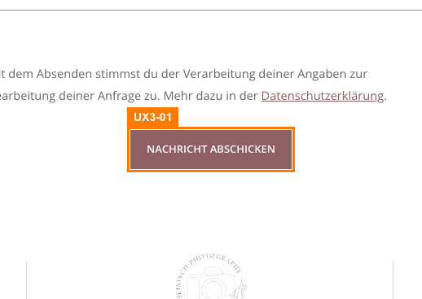

**UX3-02 (low): Fehlermeldung klebt am Feld: Textoberkante liegt unter dem Rahmen**

Nach leerem Absenden (Desktop wie Mobil) liegt die Fehlerzeile („Bitte fülle dieses Feld aus.“, 14 px) 2,4 px innerhalb des Feldrahmens (Feld endet bei y 199,6, Zeilenbox beginnt bei 197,2, Zeilenhöhe 14,4 px bei 19 px Box). Beim Fokus-Rahmen (2 px, Offset) überdeckt der Rahmen die Oberkante der Buchstaben im ersten Fehlerfeld (siehe Screenshot nach leerem Absenden). Zwischen den Feldern bleiben dagegen über 40 px Leerraum. Nur im Fehlerzustand sichtbar, deshalb zeigt der Screenshot das Feld.

Empfehlung: margin-top: 6px und line-height: 1.4 für .errors.help-block, der Leerraum zwischen den Gruppen dafür etwas verkleinern.

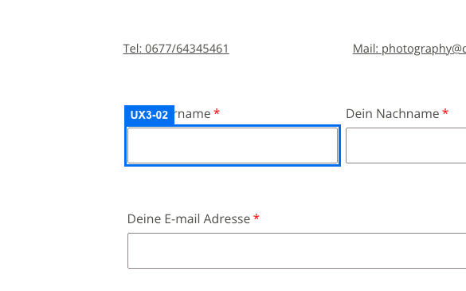

**UX3-03 (low): Radiogruppe ohne Gruppenname; Select-Name weicht vom sichtbaren Text ab**

Die vier Radios stehen in einem div ohne fieldset/legend oder role=radiogroup; das sichtbare „Für welche Fotorichtung interessierst du dich?“ ist ein <label for> auf eine nicht vorhandene id, die Frage gehört also zu keinem Eingabeelement. Screenreader lesen nur „Babybauchfotografie, Radiobutton“. Das Select hat aria-label „Wie bist du auf mich aufmerksam geworden?“, sichtbar steht aber „Wie hast du von mir erfahren?“ (WCAG 2.5.3, Label in Name).

Empfehlung: Radios in fieldset mit legend (sichtbarer Frage) bzw. role=radiogroup mit aria-labelledby; aria-label des Selects auf den sichtbaren Text („Wie hast du von mir erfahren?“) setzen.

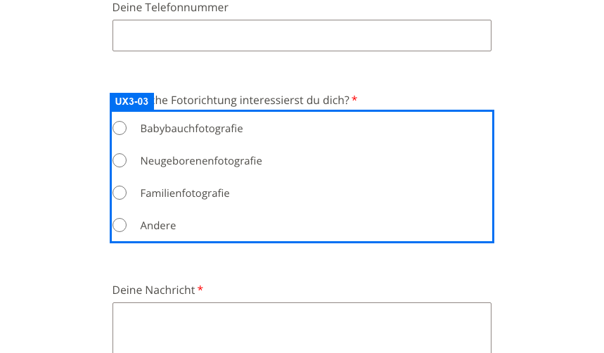

**UX3-04 (low): WhatsApp: Chat-Eintrag wirkt bei geöffnetem Fenster weiter aktiv (Rest von UX2-09)**

Nach Tipp auf den WhatsApp-Button (Fenster offen, Zustimmung noch nicht erteilt) hat .wa__popup_content_item opacity 1 und pointer-events: none; die CSS-Regel opacity .5 wirkt nur im geschlossenen Zustand, die Öffnungs-Animation überschreibt sie. Der Eintrag „danielaheinischphotography“ mit Avatar und WhatsApp-Symbol sieht normal klickbar aus, ein Tipp bewirkt nichts und hebt den Hinweis nicht hervor. Der Screenshot zeigt den geschlossenen Button, der Zustand entsteht nach dem Antippen.

Empfehlung: opacity .5 und filter: grayscale(1) mit !important auf .pointer-disable setzen (auch im Zustand .wa__lauch) und bei Tipp darauf die Checkbox-Zeile kurz hervorheben.

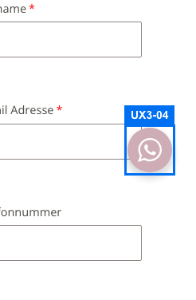

**UX3-05 (low): Überschriftenstruktur: Ablauf-Schritte rückwärts, h1→h3-Sprünge, Über mich beginnt mit h2 (Rest von UX2-07)**

Auf /ablauf/ stehen die Schritte im DOM als 03, 02, 01 („Eure Bilder“, „Der große Tag“, „Das Kennenlernen“), visuell von links 01 nach rechts 03; Screenreader lesen sie rückwärts. h1 folgt direkt auf h3 (Sprung h1→h3) auf /ablauf/, /liebe-worte/, /danke-seite/ und den vier Orts-Seiten. /ueber-mich/ beginnt mit h2 „Über mich“ (y 240) und h3 vor der h1 (y 539).

Empfehlung: DOM-Reihenfolge 01-02-03 (flex-direction/order statt Umkehr im Markup), Schritte als h2, auf /ueber-mich/ die h1 an den Anfang.

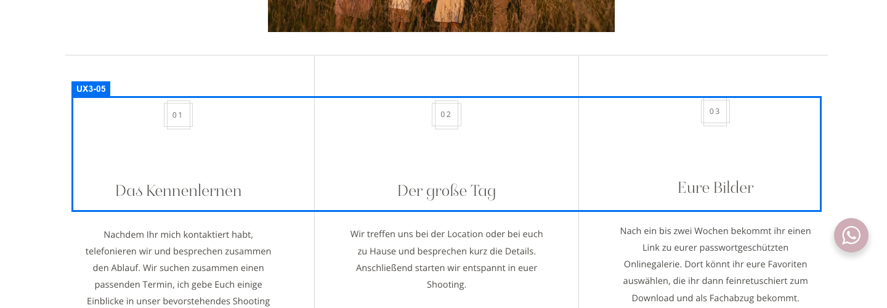

**UX3-06 (low): Mobilmenü ist nicht modal: Tab wandert hinter das offene Menü**

Nach dem Öffnen (Fokus auf „Menü schließen“) läuft Tab durch die sieben Links, dann zu WhatsApp, dann zu Elementen der Seite hinter dem Overlay („Zum Inhalt springen“, Logo, „Tel: …“, „Mail: …“); das Overlay hat weder role=dialog noch aria-modal oder Fokusfalle. Tastaturnutzer (Tablet mit Tastatur, Switch) verlieren den sichtbaren Fokus. Escape schließt das Menü korrekt.

Empfehlung: Overlay als role=dialog aria-modal=true mit Fokusfalle (Tab am Ende zurück zum Schließen-Button) oder die Seite dahinter inert setzen.

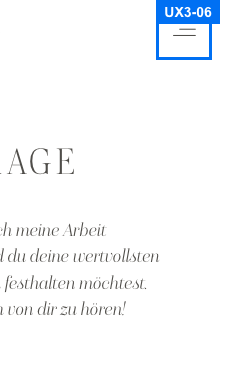

**UX3-07 (low): Galerie: bis zu 97 Tab-Stopps vor dem Seitenende, kein Sprung hinter die Galerie**

Jedes Galeriebild ist ein Link (aria-label „… vergrößern“); Hochzeit 97, Familien 95, Baby/Kleinkind 88 Tab-Stopps zwischen den Galerie-Chips und der Anfrage/dem Footer. Der Skip-Link springt nur zum Inhaltsanfang. Tastaturnutzer müssen entweder 90+ Mal Tab drücken oder die Seite scrollen. Die Lightbox selbst funktioniert gut (Pfeiltasten, Escape gibt den Fokus zurück, 44-px-Buttons).

Empfehlung: Vor dem Raster einen Link „Zur Anfrage / zum Seitenende springen“ (visible on focus) oder Roving-Tabindex im Raster (ein Tab-Stopp, Pfeiltasten wechseln das Bild).

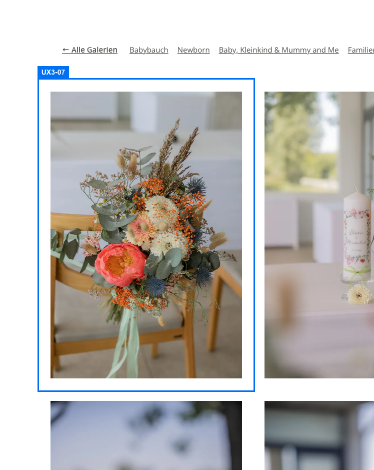

**UX3-08 (low): Alt-Texte: Bild-Links ohne Namen, Instagram-Bilder mit Hashtag-Romanen (Rest von UX2-08)**

Auf /portfolio/ haben die Bild-Links zu /gallery/newborn/ und /gallery/portrait/ nur ein Bild mit alt="" und keinen Text (Link ohne zugänglichen Namen; daneben steht jeweils ein Text-Link, der Bild-Link ist doppelt). Auf der Startseite tragen die fünf Instagram-Bilder als Alt die kompletten Post-Texte mit 208–471 Zeichen und Hashtag-Ketten („#familyphotographer#mummyandme#…“), die Screenreader vorlesen; die Bilder darunter wiederholen 20-mal dieselben sechs Standard-Alts.

Empfehlung: Bild-Link mit aria-label (Galeriename) oder alt="Neugeborenenshooting"; Instagram-Alts auf einen kurzen Satz kürzen, Hashtags entfernen.

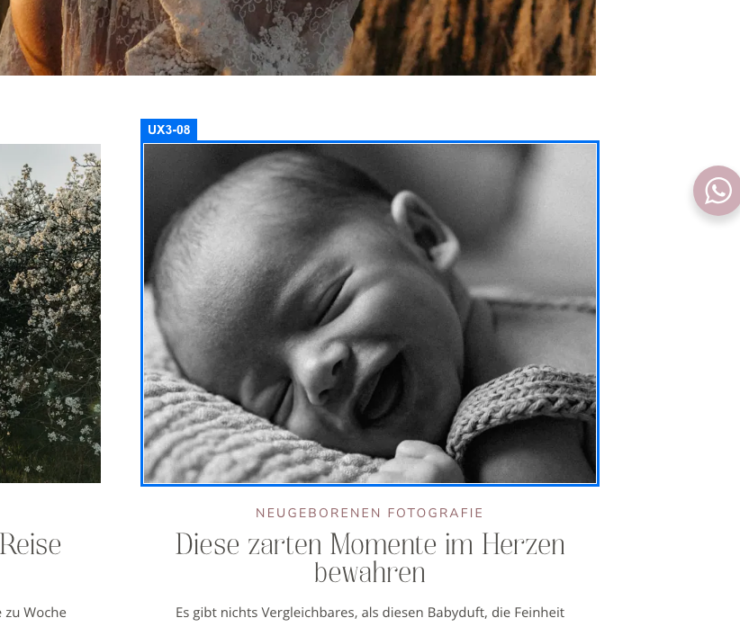

**UX3-09 (low): Mobil: einzelne Buttons und Kontaktzeilen unter 44 px Höhe**

„Jetzt anfragen“ auf /ueber-mich/ misst 139×34 px, „Mehr Liebe Worte“ auf der Startseite 165×39 px; auf /kontakt-2/ sind „Tel: 0677/64345461“ und „Mail: …“ die wichtigsten Kontaktlinks, aber nur 25 px hoch und direkt untereinander (Zeilenabstand 25 px), Fehltipps wahrscheinlich. Alle anderen Buttons (Hero, Anfrage-Abschnitt, Footer) sind 43–48 px.

Empfehlung: min-height 48 px für alle Buttons (padding), Tel-/Mail-Links auf /kontakt-2/ mit padding 10 px und display:inline-block bzw. als Buttons gestalten.

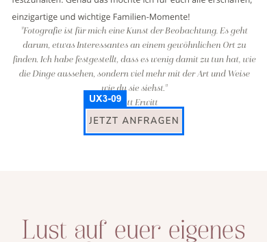

**UX3-10 (low): „BACK TO TOP“: englische Beschriftung, nur 66×19 px**

Der Zurück-nach-oben-Link am Seitenende ist als einziger Bedienknopf englisch („Back to Top“ bzw. Accessible Name „Back to Top“) auf der deutschsprachigen Seite und mobil nur 66×19 px groß (Desktop 109×41). Auf allen 23 Seiten vorhanden; auf dem Handy ist er schwer zu treffen.

Empfehlung: Beschriftung „Nach oben“ (auch aria-label), mobil min. 44×44 px Trefferfläche.

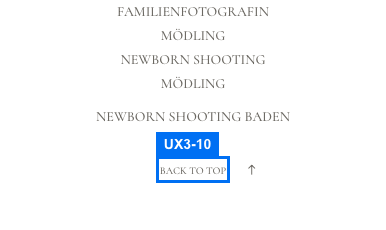

**UX3-11 (low): Zwei Galerie-Übersichten; in den Galerien ist kein Menüpunkt aktiv**

Der Menüpunkt „Galerie“ führt zu /portfolio/ (Genre-Teaser), „← Alle Galerien“ in jeder Galerie aber zu /gallery/ (Karten mit Foto-Anzahl) – zwei verschiedene Seiten mit gleichem Titel „Galerie“. Auf /gallery/ und /gallery/familien/ trägt kein Menüpunkt aria-current; bei „Galerie“ fehlt die Markierung, Orientierung geht verloren (Orts-Seiten ebenfalls ohne aktiven Punkt, dort aber ohne Zuordnung nötig).

Empfehlung: Eine Übersicht als Ziel für Menü und „Alle Galerien“ (z. B. Menü → /gallery/ oder /portfolio/ umleiten) und „Galerie“ im Menü auf allen /gallery/*-Seiten als aktiv markieren.

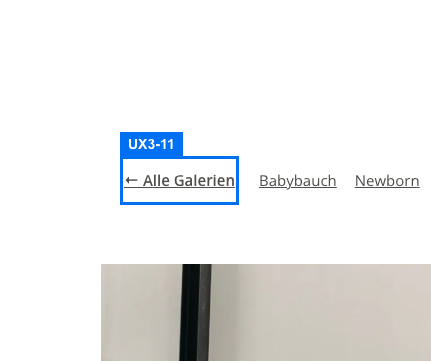

**UX3-12 (low): Desktop-Footer: Rechtslinks 11 px, Orts-Links 12 px/14 px hoch (Rest von UX2-05)**

Mobil behoben, am Desktop (1440) sind „Impressum“ und „Datenschutzerklärung“ 11,25 px groß, 26 px hoch mit weiter Sperrung; die vier Orts-Links 12 px bei 14 px Trefferhöhe, in einer Zeile mit Trennstrichen. Pflichtlinks sind schwer zu entdecken und für ältere Besucher kaum lesbar.

Empfehlung: Rechtslinks 13–14 px, Orts-Links 13 px mit 8 px Abstand zwischen den Links.

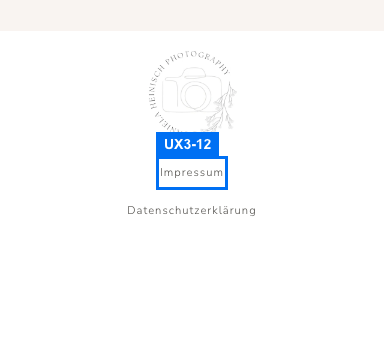

**UX3-13 (low): Danke-Seite: Sackgasse, Instagram nicht verlinkt, für Suchmaschinen indexierbar**

Im Inhalt steht „Aktuelles findet Ihr auch auf meiner Instagram-Seite“, aber ohne Link und ohne Button (main enthält 0 Links); weiter geht es nur über Menü/Footer. Die Seite ist per URL ohne Absenden erreichbar (Titel „Danke Seite“), hat robots „index, follow“ und steht in sitemap.xml; Besucher könnten sie über Google als Seite „Danke für deine Nachricht“ finden.

Empfehlung: Button „Zur Startseite“ und „Instagram ansehen“ ergänzen, Seitentitel „Danke für deine Nachricht“, robots noindex und aus der Sitemap entfernen.

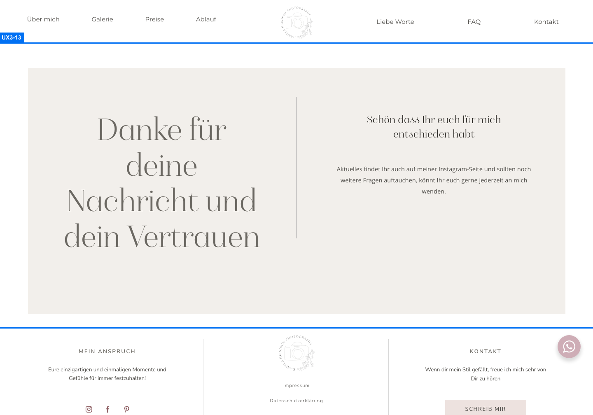

**UX3-14 (medium, extern): Impressum: deutsche Rechtsgrundlage (§ 5 TMG), Angaben für Österreich unvollständig**

Das Impressum nennt „Angaben gemäß § 5 TMG“ (deutsches Telemediengesetz, seit 2024 DDG), obwohl die Betreiberin in Mödling (Österreich) sitzt. Für österreichische Gewerbetreibende verlangt § 5 ECG u. a. Unternehmensgegenstand, ggf. UID-Nummer, Gewerbebehörde/Kammer und Berufsrecht. Diese Angaben fehlen. Keine Rechtsberatung: bitte prüfen lassen; nur die Kundin bzw. ihr Steuerberater kann die Daten liefern.

Empfehlung: Impressum nach § 5 ECG / § 63 GewO ergänzen (Unternehmensgegenstand, UID, Gewerbebehörde, Kammer); Überschrift „Angaben gemäß § 5 ECG“.

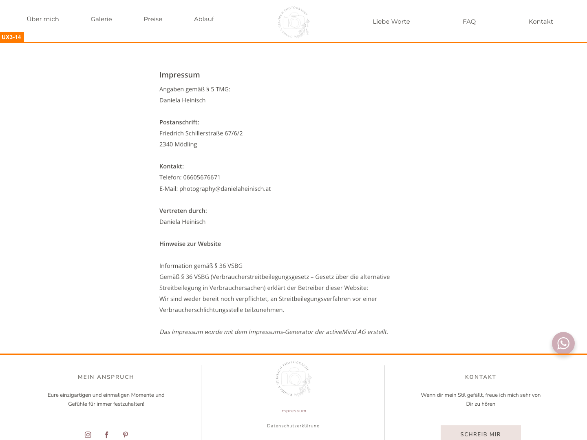
