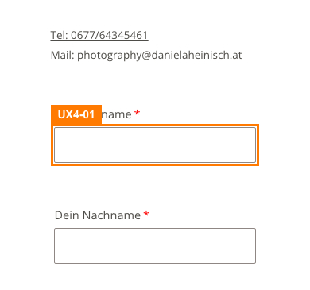
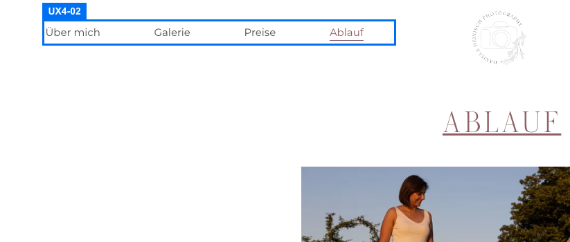
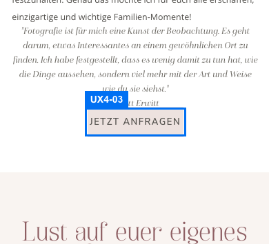
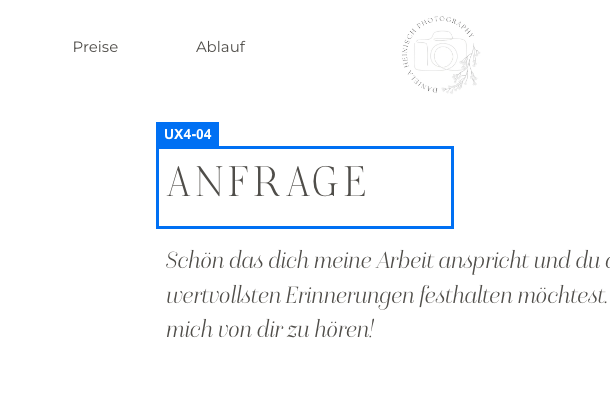
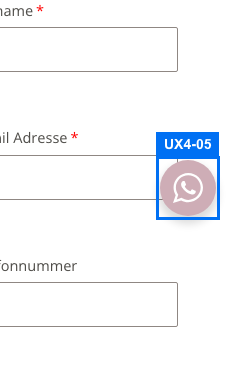
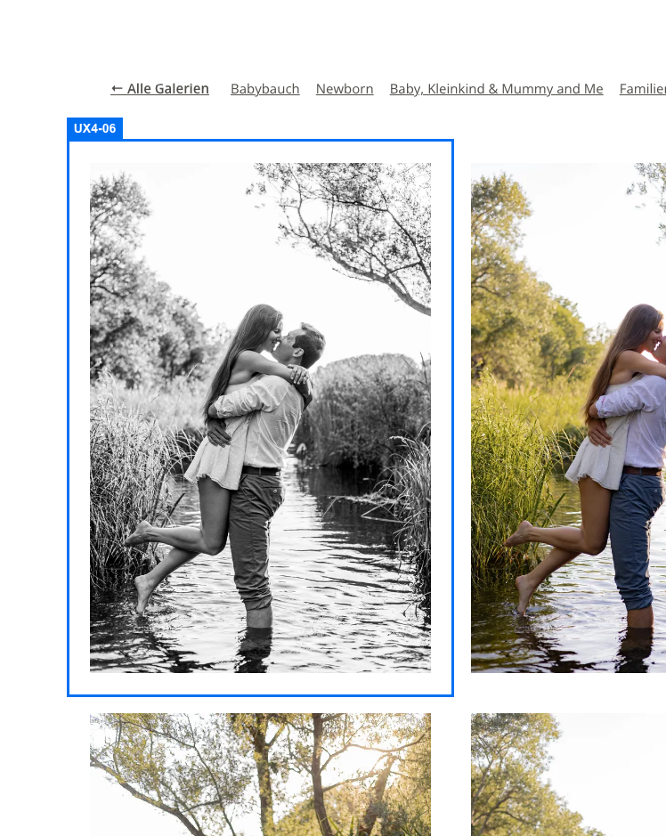
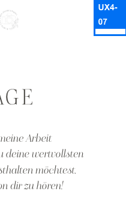
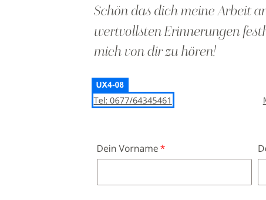
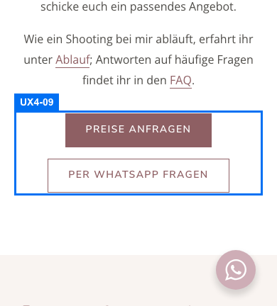
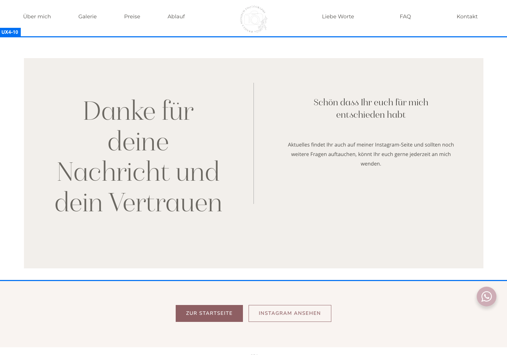

# UX-Review Runde 4

Stand: http://localhost:4321, geprüft mit Playwright (laptop-1440, tablet-1024, mobile-390) auf allen 21 Seiten aus `scripts/qa/pages.txt`. Das Formular wurde nur leer oder ungültig abgesendet. Der Versand-Endpoint wird nicht bewertet (extern, Hosting); bewertet ist das Fallback-Verhalten.

## Punkte

| Kriterium | Punkte | Begründung |
| --- | --- | --- |
| navigation | 9,5 | Keine toten Links (alle internen Ziele 200, Anker vorhanden), aktiver Menüpunkt auch in Galerien, deutsche 404 mit Wegen. Nur UX4-10 (low). |
| conversion | 9,5 | Anfrage-Button im Hero, Anfrage-Abschnitte, WhatsApp, Telefon und Mail auf allen Seiten. Nur UX4-09 (low, doppelter CTA-Block auf /preise/). |
| formulare | 9 | Deutsche Meldungen, aria-invalid/describedby, Fokus auf erstes Fehlerfeld unter dem Sticky-Header, Radiogruppe benannt, Fallback-Statusmeldung vorhanden. UX4-01 (medium): Felder mobil 15 px, iOS zoomt beim Antippen. Dazu UX4-04 (low). |
| mobile_bedienung | 9,5 | Menü und Schließen 48 px, Footer 44 px, Slider/Lightbox-Buttons 44 px. Nur UX4-03 und UX4-05 (low). |
| barrierefreiheit | 9,5 | Alle Tab-Stopps mit sichtbarem Fokus (11 Seiten), genau eine h1 je Seite ohne Ebenensprünge, Skip-Links, ARIA-Tabs, modales Menü. UX4-02, UX4-06, UX4-07 (low). |
| vertrauen_inhalt | 9,5 | Verständliche Inhalte, Preise-Seite, Rechtsseiten erreichbar. Nur UX4-08 (low). Impressum-Rechtsinhalt ist extern (UX3-14). |

## Verifikation Runde 3

| ID | Status | Beleg |
| --- | --- | --- |
| UX3-01 | behoben | contact-form.ts: ohne meta hs-contact-endpoint zeigt der gültige Fallback showStatus() einen role=status-Hinweis mit Mail-Link (.hs-form-status, Rosé-Rand, 15 px) direkt unter dem Absenden-Button. Gültiger Versand bewusst nicht ausgelöst; per Quelltext/CSS geprüft. Endpoint = Hosting (extern). |
| UX3-02 | teilweise | Fehlerbox hat margin-top 6 px, die Box liegt aber nur 0,6 px unter dem Feld (Feld endet y 199,6, Box y 200,2; Span-Zeile y 197,2). Im 3x-Screenshot berührt die Textoberkante den 2-px-Fokusring des ersten Fehlerfelds. Rest als UX4-04. |
| UX3-03 | behoben | [role=radiogroup] mit aria-labelledby=hs-radio-label-0 (Text: Für welche Fotorichtung interessierst du dich?); Select-Name = sichtbarer Text Wie hast du von mir erfahren?. |
| UX3-04 | behoben | Mobil nach Tipp auf den WhatsApp-Button: .wa__popup_content_item opacity 0.5, filter grayscale(1), pointer-events none. |
| UX3-05 | behoben | /ablauf/: h1, dann h2 Das Kennenlernen / Der große Tag / Eure Bilder in Leserichtung, keine Ebenensprünge auf allen 21 Seiten und 3 Viewports (Skript-Messung); /ueber-mich/ beginnt mit h1. |
| UX3-06 | behoben | Mobilmenü role=dialog aria-modal, Fokus beim Öffnen auf Schließen-Button, Escape schließt und gibt Fokus an den Menü-Button zurück, geschlossen inert=true. Einziger Rest: Skip-Link wird beim Tab-Zyklus erreicht (UX4-07). |
| UX3-07 | behoben | Auf allen 7 Galerieseiten Link Galerie überspringen (#hs-gallery-end) vor dem Raster, Ziel existiert, wird beim Fokus sichtbar. |
| UX3-08 | behoben | Portfolio: alle Bild-Links mit Namen (z. B. Babybauch Fotografie: Beispielfoto); keine Alt-Texte über 130 Zeichen oder mit Keyword-/Hashtag-Ketten auf 21 Seiten. |
| UX3-09 | teilweise | Mobil-390: Builder-Button JETZT ANFRAGEN auf /ueber-mich/ nur 34 px hoch (139x34), MEHR LIEBE WORTE auf / 39 px; Mobilmenü-Einträge 42 px. Tel/Mail-Zeilen sind jetzt 44 px. Rest als UX4-03. |
| UX3-10 | behoben | Beschriftung NACH OBEN, Trefferfläche 68x44 px. |
| UX3-11 | behoben | /gallery/ leitet auf /portfolio/ weiter (noindex-Weiterleitungsseite), in Galerien trägt Galerie aria-current, Zusatznavigation Galerien vorhanden. |
| UX3-12 | behoben | Desktop-Footer: Rechtslinks 13 px, Trefferhöhe 29 px, Orts-Links 36 px; mobil 44 px. |
| UX3-13 | teilweise | Danke-Seite hat jetzt Buttons Zur Startseite und Instagram ansehen (Sackgasse behoben), steht nicht mehr in der Sitemap, trägt aber weiter robots index,follow. Rest als UX4-10. |
| UX3-14 | offen | Impressum-Rechtsinhalt kann nur die Kundin klären (extern, wartet auf Kundin); begrenzt die Punkte nicht. |

Summe: 10 behoben, 3 teilweise (UX3-02, UX3-09, UX3-13), 1 offen und extern (UX3-14).

## Neue Funde

| ID | Schwere | Kriterium | Seite / Viewport | Titel |
| --- | --- | --- | --- | --- |
| [UX4-01](annotated/UX4-01.png) | medium | formulare | /kontakt-2/ / mobile-390 | Formularfelder mobil 15 px: iPhone zoomt beim Antippen in die Seite |
| [UX4-02](annotated/UX4-02.png) | low | barrierefreiheit | /ablauf/ / laptop-1440 | Hauptmenü und Footer-Links ohne nav-Landmark |
| [UX4-03](annotated/UX4-03.png) | low | mobile_bedienung | /ueber-mich/ / mobile-390 | Rest von UX3-09: einzelne Buttons mobil unter 44 px |
| [UX4-04](annotated/UX4-04.png) | low | formulare | /kontakt-2/ / laptop-1440 | Rest von UX3-02: Fehlertext klebt weiter am Feld |
| [UX4-05](annotated/UX4-05.png) | low | mobile_bedienung | /kontakt-2/ / mobile-390 | WhatsApp-Button liegt über Formularfeldern und über der geöffneten Lightbox |
| [UX4-06](annotated/UX4-06.png) | low | barrierefreiheit | /gallery/paare/ / laptop-1440 | Lightbox: vergrößertes Foto ohne Alternativtext |
| [UX4-07](annotated/UX4-07.png) | low | barrierefreiheit | /kontakt-2/ / mobile-390 | Rest von UX3-06: Skip-Link wird hinter dem modalen Mobilmenü erreicht |
| [UX4-08](annotated/UX4-08.png) | low | vertrauen_inhalt | /kontakt-2/ / laptop-1440 | Telefonnummer und Seitentitel uneinheitlich geschrieben |
| [UX4-09](annotated/UX4-09.png) | low | conversion | /preise/ / mobile-390 | Preise: doppelter Anfrage-Block und verwaister Trenner nach der Telefonnummer |
| [UX4-10](annotated/UX4-10.png) | low | navigation | /danke-seite/ / laptop-1440 | Rest von UX3-13: Danke-Seite weiter für Suchmaschinen indexierbar |

## Details

### UX4-01 (medium, formulare) Formularfelder mobil 15 px: iPhone zoomt beim Antippen in die Seite

Auf 390 px haben alle Eingabefelder (Vorname, Nachname, E-Mail, Telefon, Nachricht, Select) font-size 15 px; das Viewport-Meta lautet nur width=device-width, initial-scale=1. Safari auf iOS zoomt bei Fokus auf Felder unter 16 px automatisch heran; die Seite springt seitlich und muss wieder herausgezoomt werden. Das trifft jeden iPhone-Besucher auf dem wichtigsten Anfrageweg. (Verhalten folgt aus dem bekannten WebKit-Verhalten und der gemessenen Schriftgröße, nicht aus einem echten iOS-Gerät.)

Empfehlung: Eingaben, Textarea und Select mobil auf mindestens 16 px setzen (z. B. @media (max-width: 767px) { form input, form textarea, form select { font-size: 16px } }).

### UX4-02 (low, barrierefreiheit) Hauptmenü und Footer-Links ohne nav-Landmark

Auf allen 14 Inhaltsseiten gibt es kein <nav> und kein role=navigation; Hauptmenü und Fußzeilenlinks sind lose Divs. Screenreader-Nutzer können per Landmark-Liste nicht zum Menü springen. Nur die Galerie-Unternavigation ist ein nav.

Empfehlung: Hauptmenü-Container als <nav aria-label="Hauptmenü"> (bzw. role=navigation) auszeichnen, Footer-Links als nav aria-label="Fußzeile".

### UX4-03 (low, mobile_bedienung) Rest von UX3-09: einzelne Buttons mobil unter 44 px

Mobil-390: Builder-Button JETZT ANFRAGEN auf /ueber-mich/ misst 139x34 px, MEHR LIEBE WORTE auf der Startseite 165x39 px; Mobilmenü-Einträge sind 42 px hoch (Sollwert 44 px).

Empfehlung: Builder-Buttons mobil min-height 44 px (wie .hs-btn mit 48 px) und Mobilmenü-Zeilen auf 44 px bringen.

### UX4-04 (low, formulare) Rest von UX3-02: Fehlertext klebt weiter am Feld

Nach leerem Absenden liegt der Fehler-Block 0,6 px unter dem Feld (Feld bis y 199,6, Block y 200,2, Textzeile ab y 197,2). Die Textoberkante der Meldung berührt die Feldkante bzw. den 2-px-Fokusring des ersten Fehlerfelds; der margin-top von 6 px wirkt nicht.

Empfehlung: Fehlerzeile mit display:block; padding-top 6 px und line-height 1.4 versehen oder die Gruppe um 6 px nach unten schieben.

### UX4-05 (low, mobile_bedienung) WhatsApp-Button liegt über Formularfeldern und über der geöffneten Lightbox

Der feste 56-px-Button (rechts unten, z-index 999999999) überdeckt beim Scrollen durch das Formular den rechten Rand von E-Mail-Feld, Nachrichtenfeld und Select (Überdeckung bis ca. 700 px² je Feld, im Screenshot den Auswahlpfeil des Selects). In der Galerie-Lightbox (z-index 99992) liegt er ebenfalls über dem Foto. Die Felder bleiben nutzbar, der Pfeil/Resize-Griff nicht.

Empfehlung: Button auf Formularseiten bei Fokus in ein Feld ausblenden oder weiter an den Rand setzen; in der Lightbox z-index unter die Lightbox legen.

### UX4-06 (low, barrierefreiheit) Lightbox: vergrößertes Foto ohne Alternativtext

Die Galerie-Links tragen Namen (Paare: Foto 10 von 58 vergrößern), aber in der geöffneten Lightbox hat .fancybox-image alt="" und es gibt keine Bildunterschrift. Screenreader-Nutzer erfahren im Dialog (Name Bildergalerie) nicht, welches Bild sie sehen (nur der Zähler 10 / 58).

Empfehlung: Dem Lightbox-Bild den Alt-Text des Galerie-Links (Paare: Foto n von m) setzen.

### UX4-07 (low, barrierefreiheit) Rest von UX3-06: Skip-Link wird hinter dem modalen Mobilmenü erreicht

Bei geöffnetem Menü wandert Tab durch die sieben Menüeinträge und landet beim achten Tab auf Zum Inhalt springen (außerhalb des Dialogs, Seite ist nicht inert), danach wieder im Menü. Der Skip-Link wirkt hinter dem offenen Menü sinnlos.

Empfehlung: Skip-Link beim Öffnen des Menüs ebenfalls inert setzen oder in den Dialog verlegen.

### UX4-08 (low, vertrauen_inhalt) Telefonnummer und Seitentitel uneinheitlich geschrieben

Kontaktseite zeigt Tel: 0677/64345461, alle anderen Seiten 0677 / 643 454 61. Titel: Startseite Daniela Heinisch Photography- Familienfotografin (Bindestrich ohne Leerzeichen), Preise mit Gedankenstrich, Danke-Seite Danke Seite. Gleiche Nummer, aber unterschiedliches Erscheinungsbild wirkt unsauber.

Empfehlung: Eine Schreibweise verwenden (0677 / 643 454 61) und Titel vereinheitlichen (Name – Seite).

### UX4-09 (low, conversion) Preise: doppelter Anfrage-Block und verwaister Trenner nach der Telefonnummer

Auf /preise/ folgen auf Preise anfragen / Per WhatsApp fragen direkt Lust auf euer eigenes Shooting? mit Jetzt anfragen / Per WhatsApp schreiben: vier Buttons für dieselben zwei Wege. Mobil steht hinter 0677 / 643 454 61 ein einzelner Mittelpunkt in der Zeile, die E-Mail bricht darunter um.

Empfehlung: Auf Preise-Seite den zweiten Anfrage-Abschnitt weglassen oder nur einen CTA-Block behalten; Trenner mobil ausblenden.

### UX4-10 (low, navigation) Rest von UX3-13: Danke-Seite weiter für Suchmaschinen indexierbar

Die Seite hat robots index, follow und Titel Danke Seite. Sie steht nicht mehr in der Sitemap, kann aber über Suche gefunden werden; Besucher landen dann ohne Anfrage auf einer Bestätigung. (Entwickler: noindex senkte Lighthouse-SEO.)

Empfehlung: noindex,follow setzen oder per robots.txt ausschließen; die Lighthouse-Bewertung ist dafür kein Grund.

