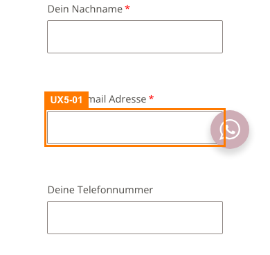
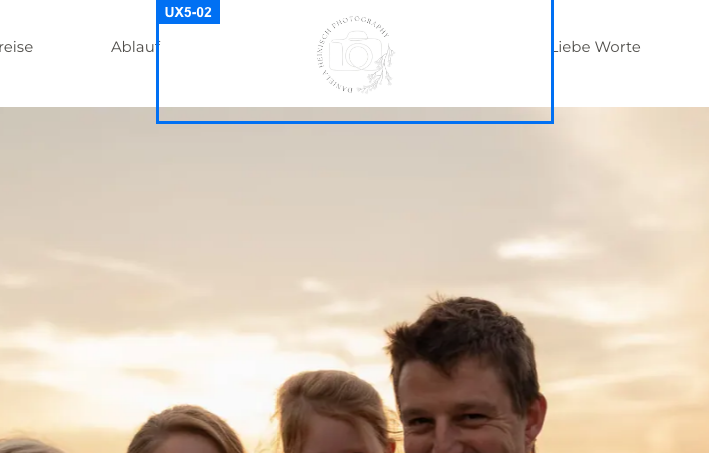
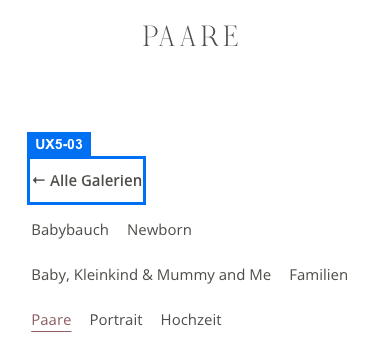
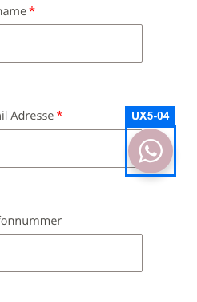
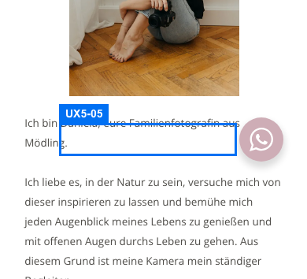
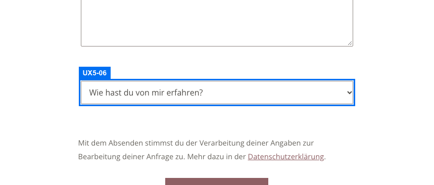
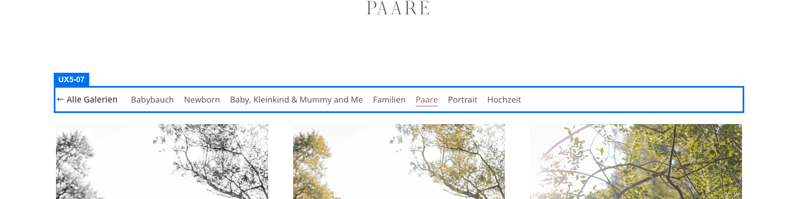
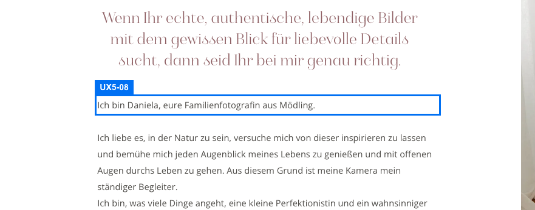
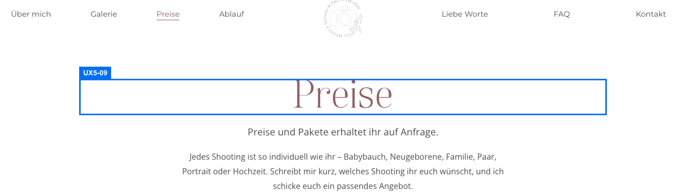

# UX-Review Runde 5 (Daniela Heinisch Photography)

Geprüft mit Playwright auf laptop-1440, tablet-1024 und mobile-390 über alle 21 Seiten aus `scripts/qa/pages.txt` (Tastatur, Klicks, leeres und ungültiges Absenden des Formulars, Messungen). Das Formular wurde nie gültig abgesendet. Verhalten ohne `NEXT_PUBLIC_CONTACT_ENDPOINT` (Fallback per mailto mit klarem Hinweistext) wurde als extern gewertet.

## Punkte

| Kriterium | Punkte | Begründung |
| --- | --- | --- |
| navigation | 10 | Menü, Mobilmenü (Fokusführung, Escape), Galerie-Unterseiten, 404 und alle 496 internen Links fehlerfrei; aria-current im Menü gesetzt. Keine Funde. |
| conversion | 10 | Jetzt anfragen im Hero, WhatsApp-Button, Footer-CTA und Telefon/Mail auf jeder Seite erreichbar; Preise-Seite mit einem klaren Block. Keine Funde. |
| formulare | 9 | UX5-01 (medium, offen): Fehlermeldung überlappt auf Mobil das Feld. Dazu UX5-06 (low). Positiv: 16-px-Felder, Autocomplete, deutsche Meldungen, Fokus auf erstes Fehlerfeld, role=alert. |
| mobile_bedienung | 9,5 | Nur low: UX5-03, UX5-04, UX5-05. Menü, Buttons und Lightbox-Bedienelemente haben 44 bis 48 px. |
| barrierefreiheit | 9,5 | Nur low: UX5-02, UX5-07, UX5-08. Landmarks, Lightbox-Alt, Reiter mit Pfeiltasten, Menüfokus funktionieren. |
| vertrauen_inhalt | 9,5 | Nur low: UX5-09. Impressum und Datenschutz in jeder Fußzeile erreichbar (rechtliche Inhalte extern). |

## Verifikation der Runde-4-Funde

| ID | Status | Nachweis |
| --- | --- | --- |
| UX4-01 | behoben | Mobil-390 /kontakt-2/: Vorname, Nachname, E-Mail, Telefon, Nachricht und Select haben font-size 16 px (vorher 15 px); kein iOS-Fokuszoom mehr zu erwarten. Autocomplete gesetzt (given-name, family-name, email, tel). |
| UX4-02 | behoben | Auf allen 21 Seiten gibt es benannte Navigations-Landmarks (Hauptmenü links/rechts, Rechtliches; auf Galerieseiten zusätzlich Galerien). Rest: doppelter Name auf Galerieseiten, siehe UX5-07. |
| UX4-03 | behoben | Mobil-390 und Tablet-1024 über alle 21 Seiten gemessen: Builder-Buttons und Mobilmenü-Zeilen sind 48 px hoch; Menüsymbol und Schließen 48x48. Kleinere Ziele nur noch Galerie-Unternavigation (41 px) und FAQ-Reiter (42 px), siehe UX5-03. |
| UX4-04 | offen | Desktop: Fehlertext beginnt 0,6 px unter dem Feld, der 2-px-Fokusring des ersten Fehlerfelds schneidet die Oberkante der Buchstaben. Mobil-390 ist es schlimmer: die zweizeilige E-Mail-Meldung beginnt 17,8 px oberhalb der Feldunterkante und liegt über dem Feldrand. Weiter als UX5-01 geführt. |
| UX4-05 | teilweise | Lightbox: WhatsApp-Button liegt jetzt darunter (elementFromPoint im Button-Zentrum trifft die Lightbox). Auf /kontakt-2/ mobil-390 überdeckt der Button weiter Feldränder (E-Mail 843 px², Nachricht 984 px², Telefon 439 px², Select 227 px²). Rest als UX5-04. |
| UX4-06 | behoben | Lightbox-Bild trägt alt "Paare: Foto 10 von 58" (Laptop und Mobil); Dialog Bildergalerie, Fokus startet im Dialog, Escape schließt und gibt den Fokus an das Galerie-Vorschaubild zurück. |
| UX4-07 | behoben | Mobilmenü per Tastatur geöffnet: Fokus springt auf Menü schließen, Tab durchläuft die 7 Einträge, danach Browserleiste und wieder Menü schließen; der Skip-Link wird im Menü nicht mehr erreicht. Escape schließt, Fokus kehrt zum Auslöser zurück. |
| UX4-08 | teilweise | Telefonnummer einheitlich 0677 / 643 454 61 (Kontakt mit Präfix Tel:, ok). Seitentitel: Startseite und /preise/ verwenden Gedankenstrich, alle 19 übrigen Seiten Bindestrich. Rest als UX5-09. |
| UX4-09 | behoben | /preise/ mobil: nur noch ein Anfrageblock (Preise anfragen, Per WhatsApp fragen), keine Telefon-/Mailzeile mit verwaistem Trenner. |
| UX4-10 | teilweise | Danke-Seite nicht in der Sitemap, robots weiter index,follow; Titel Danke für deine Nachricht. noindex ist wegen der Lighthouse-Vorgabe des Auftraggebers bewusst nicht gesetzt, daher kein neuer Fund. |

Summe: 6 behoben, 3 teilweise, 1 offen.

## Neue Funde

### UX5-01 (medium, formulare) Rest von UX4-04: Fehlermeldung überlappt das Eingabefeld

Seite /kontakt-2/, mobile-390. Reproduktion: Seite öffnen, Vorname, Nachname und Nachricht füllen, E-Mail "abc", Absenden. Die zweizeilige Meldung "Bitte gib eine gültige E-Mail-Adresse ein (z. B. name@beispiel.at)." ist absolut positioniert und wächst nach oben: ihre erste Zeile beginnt 17,8 px oberhalb der Feldunterkante und liegt über dem unteren Feldrand (Text 401,9 bis 436,3, Feld bis 419,8). Das ist die häufigste Fehleingabe und betrifft jedes Telefon unter ca. 500 px Breite. Am Desktop ist die Einzeilen-Meldung nur 0,6 px vom Feld entfernt, der Fokusring des ersten Fehlerfelds schneidet die Buchstabenoberkanten.

Empfehlung: Fehlermeldung nicht absolut, sondern im Fluss unter dem Feld platzieren (display:block; margin-top:6px; position:static) oder top statt bottom verankern, sodass sie nach unten wächst; Abstand zur nächsten Gruppe per padding-bottom sichern.

### UX5-02 (low, barrierefreiheit) Logo-Link ohne sichtbaren Tastaturfokus

Seite /, laptop-1440. Beim Tabben (zweiter Tab-Stopp nach dem Skip-Link) hat der Logo-Link outline-style none und keinen box-shadow; im Screenshot ist keine Fokusmarkierung zu sehen (gleich im Footer-Logo). Alle anderen von 40 Tab-Stopps der Startseite zeigen einen Fokus.

Empfehlung: a:focus-visible für Logo-Links einen 2-px-Ring in Markenfarbe (#8e5f63) mit 3 px Abstand geben.

### UX5-03 (low, mobile_bedienung) Galerie-Unternavigation und FAQ-Reiter knapp unter 44 px

Seite /gallery/paare/, mobile-390. Die Links der Galerie-Unternavigation (Alle Galerien, Babybauch, Newborn, Paare, Portrait …) sind 41 px hoch (Paare nur 40 px breit); die sechs FAQ-Reiter auf /haeufige-fragen/ sind 42 px hoch. Sollwert 44 px. Sehr nah beieinanderliegende Ziele erhöhen Fehltreffer.

Empfehlung: min-height 44 px (Padding 12 px) für .hs-gallery-nav a und die FAQ-Reiter.

### UX5-04 (low, mobile_bedienung) Rest von UX4-05: WhatsApp-Button überdeckt beim Scrollen Formularränder

Seite /kontakt-2/, mobile-390. Der feste Button (x 304 bis 360) deckt beim Scrollen den rechten Rand von E-Mail-, Telefon-, Nachrichtenfeld und Select ab (bis 984 px²; Resize-Griff der Textarea und Select-Pfeil liegen darunter). Felder bleiben tippbar, Pfeil und Griff nicht.

Empfehlung: Auf Formularseiten (body mit form) den Button 12 px weiter rechts/unten setzen oder bei Fokus in ein Feld ausblenden.

### UX5-05 (low, mobile_bedienung) WhatsApp-Hinweisblase liegt über dem Fließtext

Seite /ueber-mich/, mobile-390. Beim Laden steht die Blase "Schreibt mir gerne per Whatsapp" (218x34 px) links neben dem Button über dem Fließtext (z. B. Zeile "Mödling.") und deckt ihn halb ab, bis zum ersten Scrollen (dann Opacity 0, pointer-events none). Schreibweise "Whatsapp" statt "WhatsApp".

Empfehlung: Blase mobil ausblenden oder nach 5 s automatisch ausfaden; Schreibweise WhatsApp.

### UX5-06 (low, formulare) Select ohne sichtbare Beschriftung

Seite /kontakt-2/, laptop-1440. Das Label des Selects "Wie hast du von mir erfahren?" ist leer (Name nur über aria-label), die Frage steht nur als erste Option im Feld. Nach der Auswahl (z. B. Instagram) ist der Kontext nicht mehr sichtbar, alle anderen Felder haben ein sichtbares Label.

Empfehlung: Sichtbares Label "Wie hast du von mir erfahren? (optional)" über dem Select, erste Option als "Bitte wählen".

### UX5-07 (low, barrierefreiheit) Zwei Navigations-Landmarks mit gleichem Namen Galerien

Seite /gallery/paare/, laptop-1440. Auf allen Galerieseiten gibt es zwei sichtbare nav aria-label=Galerien (oben nach der Überschrift und nach 10 000 px am Seitenende). In der Landmark-Liste sind sie nicht zu unterscheiden. Zusätzlich gibt es zwei Container mit dem Namen Hauptmenü rechts (einer davon leer, ohne Breite).

Empfehlung: Zweite Navigation als Galerien (Ende der Seite) benennen oder auf eine reduzieren; leeren Menü-Container ohne Landmark-Rolle ausliefern.

### UX5-08 (low, barrierefreiheit) Überschriftenreihenfolge auf Über mich: H2, H3, dann H1

Seite /ueber-mich/, laptop-1440. Sichtbare Überschriften in Lesereihenfolge: H2 Über mich, H3 Die Person hinter der Kamera, H1 Ich bin Daniela, eure Familienfotografin, danach H2. Die Seite beginnt ohne H1, die visuelle Hauptüberschrift Über mich ist ein H2. Alle anderen 20 Seiten haben genau eine H1 an erster Stelle.

Empfehlung: Über mich als H1 auszeichnen, "Ich bin Daniela …" als H2, Untertitel als Absatz oder H3 danach.

### UX5-09 (low, vertrauen_inhalt) Rest von UX4-08: Seitentitel mit uneinheitlichem Trennzeichen

Seite /preise/, laptop-1440. Die Startseite (Daniela Heinisch Photography – Familienfotografin Mödling) und /preise/ (Preise – Daniela Heinisch Photography) verwenden einen Gedankenstrich, die übrigen 19 Seiten einen Bindestrich (Ablauf - Daniela Heinisch Photography). In Tab-Leiste und Suchergebnis wirkt das uneinheitlich.

Empfehlung: Überall "Seite – Daniela Heinisch Photography" (Gedankenstrich) setzen.

