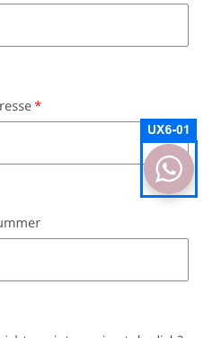
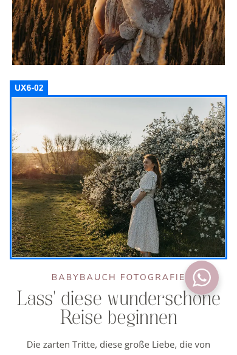
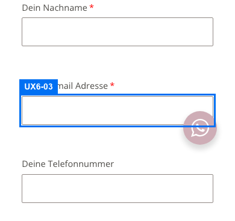

# UX-Review Runde 6 (Daniela Heinisch Photography)

Geprüft mit Playwright auf laptop-1440, tablet-1024 und mobile-390 über alle 21 Seiten aus `scripts/qa/pages.txt`: Überschriften, Titel, Alt-Texte, Touch-Ziele, Tastaturdurchlauf (Tab) auf Start, Kontakt, Galerie und FAQ, Lightbox (Enter, Pfeile, Tab-Falle, Escape, Fokusrückgabe), Formular leer und mit ungültiger E-Mail abgesendet (nie gültig). Ohne `NEXT_PUBLIC_CONTACT_ENDPOINT` wurde das Fallback-Verhalten bewertet, Versand und Impressums-Rechtstexte sind extern.

## Punkte

| Kriterium | Punkte | Begründung |
| --- | --- | --- |
| navigation | 10 | Menü, Mobilmenü, Galerie-Unternavigation, 404 mit Weg zurück; unterscheidbare Landmarks. Keine Funde. |
| conversion | 10 | Telefon, Mail, WhatsApp, Formular und Hero-CTA auf allen Seiten erreichbar. Keine Funde. |
| formulare | 9,5 | Nur low: UX6-03 (Fehlerfelder ohne roten Rahmen). Positiv: Fehlermeldung im Fluss unter dem Feld, Fokus auf erstem Fehlerfeld, 16-px-Felder, Autocomplete, sichtbares Select-Label. |
| mobile_bedienung | 9,5 | Nur low: UX6-01 (WhatsApp-Button über Feldrändern), UX6-02 (19-px-Textlinks). Buttons, Menü, Reiter und Galerie-Navigation 44 bis 48 px. |
| barrierefreiheit | 10 | Eine H1 je Seite ohne Sprünge, alle Bilder mit alt, sichtbarer Fokus bei allen Tab-Stopps (auch Logo), Lightbox mit Fokusfalle und Fokusrückgabe, geschlossene Dialoge inert. Keine Funde. |
| vertrauen_inhalt | 10 | Titel einheitlich, Impressum und Datenschutz in jeder Fußzeile (rechtliche Inhalte extern). Keine Funde. |

## Verifikation der Runde-5-Funde

| ID | Status | Nachweis |
| --- | --- | --- |
| UX5-01 | behoben | Mobil-390: Meldung beginnt 6 px unter dem Feld (Feldunterkante -214, Meldung ab -208), keine Überlappung. |
| UX5-02 | behoben | Logo-Link zeigt beim Tab einen Kreisring (Screenshot); alle Tab-Stopps haben Fokus. |
| UX5-03 | behoben | Galerie-Navigation und FAQ-Reiter mobil je 44 px hoch. |
| UX5-04 | offen | WhatsApp-Button überdeckt mobil weiter E-Mail- (1924 px²), Nachrichtenfeld (1900 px²) und Select (535 px²). Weiter als UX6-01. |
| UX5-05 | behoben | Hinweisblase mobil display none. |
| UX5-06 | behoben | Sichtbares Label und Platzhalter "Bitte auswählen". |
| UX5-07 | behoben | Landmarks "Galerien" und "Galerien (Seitenende)". |
| UX5-08 | behoben | Alle Seiten: eine H1 an erster Stelle, keine Sprünge. |
| UX5-09 | behoben | Alle Titel mit Gedankenstrich. |

Summe: 8 behoben, 0 teilweise, 1 offen.

## Neue Funde

- UX6-01 (low, mobile_bedienung) Rest von UX5-04: WhatsApp-Button über Formularfeldern. 
- UX6-02 (low, mobile_bedienung) Genre-Titel-Links auf /portfolio/ 19 px hoch, Datenschutz-Link im Formular 18 px. 
- UX6-03 (low, formulare) Fehlerfelder ohne visuelle Markierung. 
